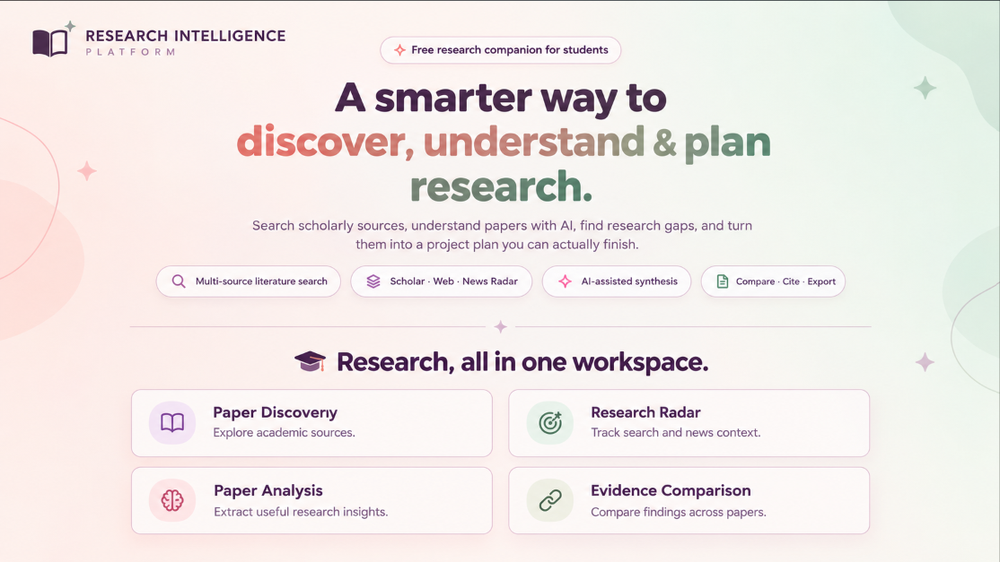

<div align="center">



### Discover research. Connect evidence. Generate insights.

[](https://python.org)
[](https://streamlit.io)
[](LICENSE)

</div>

---

# Research Intelligence Platform

A Streamlit research workspace for discovering academic papers, exploring current web context, reviewing recent research-related news, comparing evidence, and turning research questions into practical student project plans.

## ✨ Highlights

- **Multi-source academic search:** OpenAlex, Semantic Scholar, arXiv, Crossref, Europe PMC, and Google Scholar through SerpApi.
- **Research Radar:** One workflow for Google Scholar, Google Search, and Google News, powered by SerpApi's official Python SDK and Search Tools package.
- **Research Agent:** Explore supported search sources, retrieve results, and generate a research brief from those results when configured AI services are available.
- **AI-assisted paper analysis:** Summaries, possible research gaps, paper comparison, and project planning using configured AI providers, with extractive fallback when AI is unavailable.
- **Full-text support:** Open-access links, Unpaywall discovery, arXiv PDFs, and user-uploaded PDFs. Publisher restrictions such as HTTP 403 are reported clearly; abstract fallback remains available.
- **Research organization:** Workspaces, citations, and Markdown, Word, and PDF exports.
- **Student-friendly experience:** Beginner and Technical explanation modes for different levels of familiarity.
- **Security basics:** API keys are read from configuration; `.env`, databases, and virtual environments are excluded from Git.

## 🧭 Explore the workflow

| Workspace | What it helps you do |
|---|---|
| 🔎 Paper Search | Discover academic publications from supported scholarly sources. |
| 🌐 Research Radar | Explore scholarly results, web context, and research-related news. |
| 🤖 Research Agent | Use supported search tools and configured AI to prepare a research brief. |
| 📄 Paper Analysis | Review available paper content and generate useful summaries. |
| ⚖️ Compare Papers | Examine similarities and differences across selected papers. |
| 🗂️ Workspaces | Organize research and related materials. |
| 🧭 Project Planner | Turn a research question into practical project steps. |

*Feature availability depends on the current implementation, API access, and configuration.*

## 🛠️ Technology stack

- **Language:** Python
- **Web interface:** Streamlit
- **Academic discovery:** OpenAlex, Semantic Scholar, arXiv, Crossref, Europe PMC, and Google Scholar through SerpApi
- **Web and news discovery:** SerpApi integrations
- **AI assistance:** Gemini and optional supported AI providers
- **Testing:** pytest
- **Storage:** SQLite and application storage services where configured

## 🚀 Get started

### Prerequisites

- Python installed on your computer
- Git
- API keys for the services you want to enable

### 1. Clone the repository

```bash
git clone https://github.com/Nazia962/research-intelligence-platform.git
cd research-intelligence-platform
```

### 2. Create a virtual environment

**Windows PowerShell**

```powershell
python -m venv .venv
.\.venv\Scripts\Activate.ps1
```

**macOS / Linux**

```bash
python -m venv .venv
source .venv/bin/activate
```

### 3. Install dependencies

```bash
python -m pip install --upgrade pip
pip install -r requirements.txt
```

### 4. Configure environment variables

If `.env.example` exists in the project root, create a local `.env` file.

**Windows PowerShell**

```powershell
Copy-Item .env.example .env
```

**macOS / Linux**

```bash
cp .env.example .env
```

Open `.env` and add the keys for the services you intend to use. Keep the variable names consistent with the application's configuration.

### 5. Run the application

```bash
python -m streamlit run app.py
```

Open the local URL displayed in your terminal, usually `http://localhost:8501`.

## 🔑 API configuration

Configure only the services you need.

| Variable | Purpose |
|---|---|
| `SERPAPI_KEY` | Google Scholar, Google Search, Google News, and supported Research Radar integrations. Get a key from [SerpApi](https://serpapi.com/users/sign_up?plan=free). |
| `GEMINI_API_KEY` | Gemini-powered analysis when enabled. |
| `GROQ_API_KEY` | Optional AI provider if supported by your configuration. |
| `OPENROUTER_API_KEY` | Optional AI provider if supported by your configuration. |
| `CONTACT_EMAIL` | Recommended for supported scholarly and Unpaywall lookups. |
| `OPENALEX_API_KEY` | Optional key for supported higher OpenAlex allowance. |
| `S2_API_KEY` | Optional Semantic Scholar API key. |

Without a SerpApi key, supported free scholarly sources may remain available. Without an AI provider key, live AI synthesis may be unavailable, although supported offline or extractive fallbacks may still work.

**Never commit `.env`, API keys, passwords, access tokens, or database credentials to GitHub.**

For Streamlit Community Cloud, add the required settings through the app's **Settings → Secrets** interface using valid TOML syntax. The variable names must match those expected by the application.

## 🌐 Research Radar workflow

1. Enter a research topic.
2. Run a cross-source search across supported Google Scholar, Google Search, and Google News integrations.
3. Review scholarly results separately from web pages and news.
4. Generate an AI research brief from retrieved snippets and metadata when an AI provider is configured.
5. Open original source links and verify important claims.

Search snippets are discovery aids, not proof. News is not a substitute for peer-reviewed research, and a suggested research gap is a hypothesis rather than proof of novelty.

## 🧪 Tests

Run the test suite with:

```bash
pytest -q
```

The test suite is designed to use mocked API responses and should not require paid API calls.

## ☁️ Deployment

For a Streamlit-compatible host, the application can be started with:

```bash
streamlit run app.py --server.port $PORT --server.address 0.0.0.0
```

Use the startup configuration recommended by your hosting provider.

- Set secrets through the hosting platform's secret manager instead of uploading `.env`.
- Confirm that the selected deployment branch and main file path are correct.
- Check deployment logs if the application fails to start.
- Use persistent storage if workspaces or SQLite data must survive application restarts.

**Hosting note:** Free hosts with ephemeral filesystems may erase local SQLite data on restart. Accounts, workspaces, and caches can reset unless persistent storage is configured. Guest mode and JSON backups may still be available, depending on the implementation.

## ⚠️ Important limitations

- API providers enforce quotas and rate limits; search results may be cached.
- Some publishers block automated full-text downloads. The platform does not bypass access controls; use legal open-access copies or PDFs you are entitled to use.
- Scanned PDFs need OCR, which is not currently included.
- The local sign-in implementation is an MVP, not a production identity system. Public deployments should use a mature identity provider and review session management, account recovery, privacy, and security requirements.
- AI-generated summaries, comparisons, and research gaps require human verification against original sources.

## 📁 Project layout

```text
research-intelligence-platform/
├── .devcontainer/      # Development container configuration
├── .github/workflows/  # GitHub Actions workflows
├── .streamlit/         # Streamlit configuration
├── scripts/            # Project scripts
├── services/           # Search, retrieval, AI, citations, exports, storage
├── tests/              # Automated tests
├── views/              # Streamlit pages and shared UI
├── app.py              # Application entry point
├── HACKATHON.md        # Hackathon details and demo checklist
├── LICENSE             # MIT License
├── README.md           # Project documentation
├── requirements.txt    # Python dependencies
├── pytest.ini          # pytest configuration
└── render.yaml         # Render deployment configuration
```

*The layout above reflects the repository structure; update it when the project changes.*

## 🤖 Research Agent (SerpApi)

The **Research Agent** page lets the AI choose among supported SerpApi tools, including Google Scholar, Search, News, Patents, and Trends, retrieve results, and write a brief grounded in those results when configured.

See [`HACKATHON.md`](HACKATHON.md) for details, the demo script, and the submission checklist.

## 🔐 Security and responsible use

- Keep `.env` and local secrets out of version control.
- Never hard-code API keys into Python files.
- Verify important research claims against the original sources.
- Respect publisher access restrictions and use legally accessible full text.
- Review authentication, data persistence, and privacy before exposing the app to public users.

## 🗺️ Future improvements

- [ ] Improve research discovery and filtering
- [ ] Refine paper comparison and analysis workflows
- [ ] Expand research trend exploration
- [ ] Add more usage examples and screenshots
- [ ] Expand automated tests and documentation

## 🤝 Contributing

Suggestions, bug reports, and feature ideas are welcome. Open an issue to discuss an improvement before submitting a pull request.

## 📜 License

This project is licensed under the MIT License. See [`LICENSE`](LICENSE) for the complete terms.

---

<p align="center">
  Made with 🌷 and Python for curious minds.
  <br>
  <strong>Discover more. Understand better. Plan smarter.</strong>
</p>
